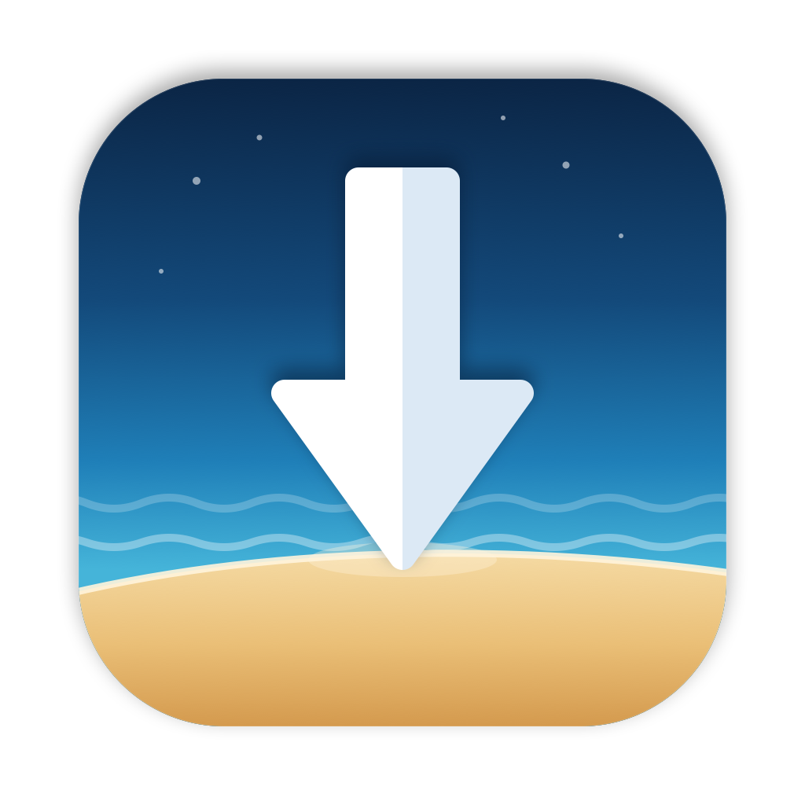

<p align="center"></p>

# Landfall

Landfall watches **Downloads**, **Desktop** and **Documents**, works out what each new file is, and files it — into your library at `~/Documents`, or into dated folders right where it landed. Everything it does is recorded, explainable and undoable.

A native macOS menu bar app and command-line tool. macOS 14+, designed for macOS 26. No dependencies.

[Install](#install) · [How it works](#how-it-works) · [Toasts](#toasts) · [Smart Filing](#smart-filing) · [The menu and Settings](#the-menu-and-settings) · [Command line](#command-line) · [Configuration](#configuration) · [Development](#development) · [Releasing](#releasing) · [Decisions](docs/adr/README.md) · [Changelog](CHANGELOG.md)

## Install

Download the latest `Landfall-x.y.z.dmg` from [Releases](https://github.com/seamoss/Landfall/releases), open it and drag Landfall to Applications. It's signed with Developer ID and notarized.

On first launch Landfall adds itself to login items, opens Settings and asks for Calendar access; macOS asks once each for Desktop, Documents and Downloads. Settings › General › Permissions shows what's granted, with a fix for anything that isn't.

From source: `./scripts/package.sh && ./scripts/install.sh` (see [Development](#development)).

## How it works

### Watched folders

| Folder | Role | Files after | Goes to |
|---|---|---|---|
| Downloads | intake | 5 minutes, once the download settles | the library; untouched items expire to the Trash after 30 days |
| Desktop | shelf | 2 hours after you last opened it | dated folders on the Desktop, e.g. `Desktop/2026-10-13/` |
| Documents | library | 30 minutes after last use | the library — loose top-level files only; folders (including `Dev`) are never touched |

Each folder's role, timing and destination are adjustable in Settings › Folders. Destinations can be the library or a cabinet in place, organized by day, day then type, month, or type ([ADR 0005](docs/adr/0005-per-folder-filing.md)).

### Modes

- **Watch** (`shadow`, the default for new installs): Landfall records what it would do and proposes it; nothing moves unless you click.
- **Suggest** (`review`): every decision waits for you in the menu bar.
- **Auto**: confident decisions happen on their own — moves at ≥ 85% confidence, trashing at ≥ 90%. The rest wait for you.

"Remove" always means the macOS Trash, every action can be undone, and anything you undo or drag back is left alone for good ([ADR 0003](docs/adr/0003-safety-model.md)).

### What it recognizes

Checked in this order; the first match decides ([ADR 0004](docs/adr/0004-ordered-deterministic-rules.md)):

1. **Ignored:** hidden files, partial downloads, anything tagged *Keep* in Finder, folders you exclude.
2. **Credentials** — `.p12`, `.pem`, `.env`, `client_secret*.json`, private keys, API tokens, recovery codes → `_Sensitive`, with an alert and an offer to import into 1Password.
3. **Your rules.**
4. **Duplicates** of files Landfall already tracks, and identical browser copies (`name (2).pdf`) → Trash.
5. **Zips already unzipped** beside themselves → Trash. **Near-empty `Untitled` files** → Trash.
6. **Installers** → Trash a day after you've opened them.
7. **Code** (git repos, projects) → `Dev/`, unless uncommitted or the name is taken.
8. **Meeting transcripts** (Tactiq) → `Meetings/<Client>/YYYY-MM/`, renamed `YYYY-MM-DD Title.txt`.
9. **Screenshots** → `Screenshots/YYYY-MM/`; localhost browser captures → `Screenshots/Dev Captures/port-N/`, older captures of the same page proposed for the Trash.
10. **Fonts, résumés** (yours → `Personal`, other people's → `Personal/Hiring`, kept private), **contact cards, 3D/CAD files, contracts, audio, video.**
11. **Clients** — by name, title, content, meeting participants, download site, or the meeting you were in when it arrived → `Clients/<Client>/`.
12. **Images**, then anything else stays put until you or Smart Filing decide.

Along the way it renames sensibly (`Report (2).pdf` → `Report.pdf`, `Another Resu,e.pdf` → `Another Resume.pdf`, hash-named images → a title or date), reads text in screenshots for search, and learns: when you re-file the same kind of thing twice, it offers to make a rule.

### Tracking

Every item is followed from the moment it lands — even when you move it yourself — in a local ledger ([ADR 0002](docs/adr/0002-sqlite-ledger-and-item-identity.md)). The menu shows what landed recently and where it went; `Desktop/Recent Landings` holds aliases to everything filed this week; an evening notification summarizes the day; `landfall why <file>` shows the full history and reasoning for any item.

## Toasts

When something new finishes landing, a card drops down under the menu bar:

- a thumbnail, the file's kind, size and where it came from;
- **→ where it's going** (✦ when Smart Filing chose it);
- a trust line only when there's something to say: downloaded and unsigned, rejected by Gatekeeper, contains macros, contains secrets;
- **File now · Keep** and the most useful action for the type, with the rest under ⋯;
- a **countdown**: when it runs out, a confident move of an ordinary file is filed, and the card becomes "Filed → …" with Undo. Hover to pause.

Actions by type:

| Kind | Actions |
|---|---|
| Documents, PDFs, transcripts | Open · Preview |
| Images, screenshots | Copy · Preview · Open |
| Archives | Unzip (refused if any entry would land outside the folder) · Preview |
| Fonts · calendar invites · contact cards | Install font · Add to Calendar · Add to Contacts |
| Code | Open in Cursor / VS Code / Zed |
| Apps | Move to Applications · Open (signed and notarized); Open… with confirmation (unsigned); nothing (rejected by Gatekeeper) |
| Installers, disk images | Install… / Open disk image (confirmation unless signed) |
| Scripts | View source first; Run in Terminal… always confirms and runs visibly |
| `.webloc` / `.fileloc` links | Open link… confirms and shows the target |
| Office documents with macros | Preview first; Open… warns |
| Credentials | Import to 1Password… · Move to _Sensitive — never Open or Preview |
| Configuration profiles | Show in Finder only |

Nothing runs without a click, and anything that can execute code asks twice. The countdown never trashes and never applies to credentials, apps, scripts, installers or code. Four or more arrivals at once collapse into one card. Details and reasoning: [ADR 0006](docs/adr/0006-custom-toasts-and-countdown.md).

## Smart Filing

An optional add-on that **reads what's inside a file** and picks its folder or client, using **your own Anthropic API key** — you pay Anthropic directly, and nothing is sent until you turn it on ([ADR 0007](docs/adr/0007-smart-filing-byok.md)).

Settings › Smart Filing:

- **API key** (kept in your login keychain) and **model**: Claude Haiku 5.5 (default — fastest, lowest cost), Sonnet 5.5 or Opus 5.5. A counter shows how many files it read this month.
- **When to use it:** only files Landfall isn't sure about, or every document with readable text. Your rules and the safety rules always come first.
- **Let Smart Filing file on its own:** off, its picks are suggestions; on, confident picks file like any other decision.
- **Privacy:** choose how much text is sent (1,500 / 4,000 / 8,000 characters). Also sent: file name, type, size, download site, your folder names, client names and aliases. **Never sent:** credentials or anything that looks like a secret, résumés and contact cards, people's names from your client list. **Try on a File…** shows the exact text before anything is sent.
- **Clients & Projects:** the names, aliases, people, sites and meetings that both Smart Filing and the built-in rules use.

## The menu and Settings

The menu bar glyph shows a count when decisions are waiting. The menu lists what needs a decision (with Apply All), what landed recently and where it went, and tools: Smart File unplaced items, import credentials to 1Password, Scan Now (⌘R), Space Report, Undo Last Action (⌘Z), Mode, Settings… (⌘,).

Settings has four panes; changes apply immediately:

- **General** — mode, permissions, toast and countdown timing (*File after*), notifications, calendar, 1Password vault, weekly disk-space report.
- **Folders** — each watched folder's role, grace period, expiry and where its items go.
- **Smart Filing** — see above.
- **Rules** — your own rules, including ones accepted from Landfall's suggestions.

## Command line

`landfall` is on your PATH after installing. Highlights:

```bash
landfall recent --since 3d          # what landed, and where it went
landfall why "Product Call"          # history and reasoning for one item
landfall where invoice               # find something by name
landfall search installer portal     # names, document text, text in screenshots
landfall review                      # decisions waiting for you
landfall apply --all                 # accept them
landfall undo                        # reverse the last move or trash
landfall mode auto                   # shadow | review | auto
landfall ai --held --dry-run         # what Smart Filing would send for unplaced items
landfall space --trash --idle 30 --yes   # clear rebuildable folders in idle projects
```

`landfall help` lists everything. `recent`, `where`, `review` and `search` take `--json`. Raycast script commands and `landfall://` URLs for Shortcuts are in [`extras/raycast`](extras/raycast/README.md).

## Configuration

`~/.config/landfall/config.json`. Settings writes it; you can also edit it by hand — partial files are fine, missing keys use defaults, and the running app reloads it within 10 seconds.

```json
{
  "mode": "auto",
  "autoFileSeconds": 15,
  "rules": [
    { "name": "Bike manuals", "nameRegex": "(?i)(vulcan|carburetor)", "to": "Personal/Vehicles" },
    { "name": "Globex calls", "participantsAny": ["Jane Doe"], "to": "Meetings/Globex/{yyyy-mm}", "rename": "{date} {title}" }
  ],
  "clients": [{ "name": "Initech", "people": ["Sam Lee", "Jane Doe"], "domains": ["initech.example"] }],
  "ai": { "enabled": true, "scope": "unsure", "model": "claude-haiku-5-5" }
}
```

| Where | What |
|---|---|
| `~/Library/Application Support/Landfall/ledger.sqlite` | items, history, search index |
| `~/Library/Logs/Landfall/landfall.log` | log; `space-report.txt` beside it |
| Login keychain, service `dev.landfall` | Anthropic API key |

## Development

```bash
swift build                      # debug build
swift test                       # core engine, rules, safety, Smart Filing eligibility
swift run landfall scan          # run the CLI against your real folders (respects mode)
.build/release/landfall toast <file> --snapshot out.png [--dark]   # render a toast offscreen
.build/release/landfall settings --snapshot out.png --tab 0        # render a Settings pane
swift scripts/make-icon.swift icon Resources/Landfall.icon         # regenerate the icon layers
```

Layout: `Sources/LandfallCore` (engine, classifier, ledger, actions — no UI), `Sources/landfall` (app, menu, toasts, Settings, CLI), `Tests/LandfallCoreTests`, `scripts/`, `docs/adr/`. Why it's built this way: [ADR 0001](docs/adr/0001-native-swift-app-and-cli.md).

## Releasing

One-time setup on the release machine: the Developer ID Application certificate in the keychain, a notary profile, and `gh` signed in:

```bash
xcrun notarytool store-credentials landfall-notary --apple-id <apple-id> --team-id 4J2T5H73JM
```

Then add notes under `## [Unreleased]` in [CHANGELOG.md](CHANGELOG.md) and run:

```bash
./scripts/release.sh 0.5.1 --dry-run   # build, sign and notarize only
./scripts/release.sh 0.5.1             # …then commit, tag, push, publish the GitHub release, install locally
```

The script refuses to publish from a dirty or out-of-date `main`, with failing tests, or without notarization. Details: [ADR 0008](docs/adr/0008-distribution.md).
